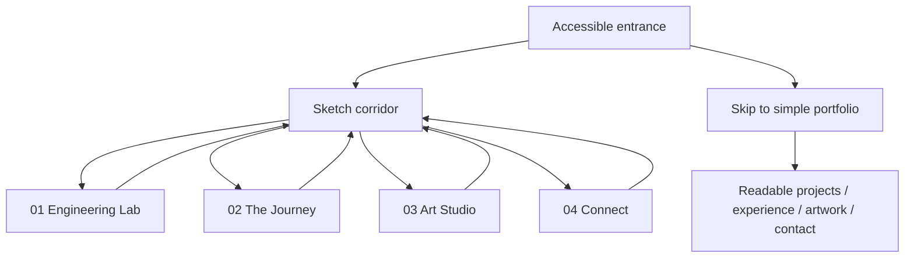

# Aayush Angal — Interactive Sketch Portfolio
## Master Design & Implementation Plan

**Version:** 1.0 · **Decision:** Graphite Sketch (A) + Sketch-to-Color (D) · **Status:** Phase 0 completed; implementation not yet approved/executed

> **North star:** An original, hand-drawn engineering world that invites exploration while letting a recruiter reach projects, experience, résumé, and contact information immediately. The site must feel authored by a developer who is also an artist—not like a generic SaaS template or a replica of ITom.

---

## 0. What we know vs. what we still need to confirm

### Grounded in `PHASE_0_RESEARCH.md`
- Existing stack: **React 18, TypeScript 5, Vite 5, Tailwind 3**, React Router, Framer Motion; already installed **Three.js 0.161, React Three Fiber 8, Drei 9, GSAP 3**.
- Current routes include `/` and `/terminal`; portfolio content is stored in typed files under `src/data/`.
- Existing backend is a **separate Express/MongoDB/Nodemailer service** with contact/resume routes; it is not proven to be hosted together with the static frontend.
- Existing Vite configuration is multi-entry; `vercel.json` describes a static Vercel deployment. **The public portfolio URL is on Render**; the actual live deployment target must be verified rather than assumed.
- Reference: [ITom](https://itomdev.com/) and [portfolio-itom](https://github.com/ITomPoland/portfolio-itom). Reference techniques include modular corridors, camera easing, door interactions, GSAP choreography, sketch/color textures and shader reveals, device quality tiers, and semantic DOM overlays.
- Reference **code** may be adapted under its MIT terms with attribution obligations; its **personal artwork, textures, writing, branding and other media are not automatically reusable**.

### To confirm before or during implementation
- Which deployment is actually serving production: Render, Vercel, or another setup; build/start commands and environment variables.
- Final résumé, project names and links, internship wording, contact details, and public-safe screenshots.
- Art Studio originals: image files, titles, medium, dates (optional), stories (optional), and publishing consent for any third-party subjects.
- Whether background music/audio is desired; default is **no autoplay audio**.
- Real mobile-device test availability and target browsers.

---

## 1. Creative direction — LOCKED

### 1.1 Visual identity
**Style:** Hand-rendered architectural graphite sketches on warm off-white paper. Color appears selectively through interaction, with ink/watercolor/colored-pencil accents. Do not use generic neon gradients, floating glass cards, sci-fi dashboards, random particles, or AI-generated stock illustrations.

**Palette (starting tokens, adjustable after visual prototype):**

| Role | Suggested color | Use |
|---|---|---|
| Paper | `#F2EEE5` | Warm background |
| Graphite | `#252525` | Outlines and headings |
| Soft pencil | `#78746E` | Secondary marks |
| Coral | `#E97855` | Interaction reveals |
| Cobalt | `#4169A8` | Engineering accents |
| Moss | `#64806B` | Art/organic accents |

These are **design proposals**, not values found in the Phase 0 document. Finalize after reviewing an actual visual prototype.

**Typography:** One expressive editorial display face paired with a highly readable body face. Check licensing, loading, legibility and fallback. Avoid faux handwriting for long passages; reserve handwritten labels for short annotations.

**Texture rules:** Visible but restrained pencil hatching, paper grain, architectural perspective lines, imperfect contours and a small number of authored doodles. Text itself remains crisp HTML, not rasterized into textures.

### 1.2 Interaction signature
1. A drawing appears to be assembled from pencil lines on entry (short, skippable).
2. Hover/focus/tap subtly highlights an object; activating it reveals color or opens its story.
3. Camera moves through the corridor with controlled easing, never trapping visitors.
4. Opening a door has a distinct transition and an obvious back/exit control.
5. Artwork remains visually authentic: do not recolor or distort the original drawing files merely to match the site theme.

### 1.3 Experience map



**Always available:** Room menu, direct links, résumé, GitHub, keyboard support, back/exit, reduced-motion handling, and a simple-view option.

---

## 2. Rooms — product requirements

### Entrance — “A world drawn between code and art”
- Clear name, concise role statement and an **Enter the world** button.
- **Skip experience / View portfolio** link visible without waiting for WebGL.
- Short sketch-drawing reveal; show useful content immediately while 3D loads.
- No blocking splash screen, forced audio, or long intro.

### Corridor — navigation spine
- Short, bounded, original architectural hallway; four unmistakably labeled doors.
- Subtle parallax, authored paper/graphite textures, waypoints or controlled forward/back navigation.
- Mouse, keyboard, touch and room-menu controls; camera animation owns camera state during transitions.
- Small interactions: labeled props, notes, drawings, and easter eggs, **never at the expense of navigation**.
- The corridor should not be an infinite maze; reference segment techniques only if profiling shows a need.

### Room 01 — Engineering Lab
- Projects displayed as original workbench objects, schematics or monitors, with a readable HTML detail panel.
- Initial featured candidates: **MEDICO.AI**, **ResearchSync**, **Elevra.ai**; confirm the latest canonical content and public links in `src/data/projects.ts`.
- Each project: problem → audience → architecture/engineering decision → implementation → result/learning → repository/demo links where public.
- Optional interactive architecture diagrams; no fake metrics, fabricated performance claims, or exposed private internship information.
- Responsive list/grid fallback containing the same material.

### Room 02 — The Journey
- Internship/work timeline, selected technical challenges, education, awards and certificates.
- Visual concept: engineering noticeboard, dated lab notes and pinned diagrams.
- Each experience item: responsibility, specific contribution, technologies only where relevant, what was learned.
- Preserve chronological accuracy and user-approved wording. Readable DOM text and downloadable résumé remain available.

### Room 03 — The Art Studio (signature room)
- Original pencil-sketched artist's room with frames, easel, sketchbook and optional desk objects.
- **Actual user drawings** are the artwork, not generated substitutes.
- Gallery data model: `id`, `title`, `image`, `thumbnail`, `alt`, optional `medium`, `year`, `story`, `progressImages`, `sortOrder`.
- Clicking/tapping a frame opens a keyboard-accessible lightbox with zoom, caption, previous/next and close.
- Optional flip-through sketchbook and before/after progress slider, only for art that has progress images.
- Load small thumbnails on room entry; fetch high-resolution images only on demand.
- Maintain original aspect ratio, accurate colors and proper attribution where necessary.
- Allow an empty-state gallery until artwork is provided; never ship placeholder art presented as the user's work.

### Room 04 — Connect
- Sketch communications console, postcard or mailbox visual, with real accessible HTML links/form.
- Résumé, GitHub, LinkedIn, email and any other user-approved destinations.
- Preserve existing contact API contract and validation; test actual deployed API origin/CORS/error states.
- Form success should only be shown after the backend confirms submission.

---

## 3. Engineering rules that apply to every phase

1. **No destructive rewrite.** Work on a feature branch, commit before each phase, and keep existing routes and content operational.
2. **Single source of truth.** Reuse `src/data/` records; 3D displays and semantic HTML views derive from the same data.
3. **One Canvas, one camera owner.** R3F updates for continuous motion; GSAP for bounded transitions; never compete for camera transforms.
4. **HTML for essential content.** Navigation, text, contact form, résumé and external links must work without canvas.
5. **Performance by design.** Lazy-load 3D, rooms and artwork; cap DPR; avoid heavy postprocessing and dynamic shadows by default.
6. **Accessibility is required.** Keyboard/focus/touch, reduced motion, contrast, alt text, large hit targets and no navigation traps.
7. **Originality and licensing.** Reuse MIT code only with appropriate notices; do not copy reference media, room layouts or branding.
8. **No invented content.** Missing project outcomes, testimonials, drawings or links stay as clearly labeled placeholders in development, not published facts.
9. **No silent package upgrades.** Preserve current compatible major versions until justified and tested.
10. **No deployment without approval.** Every phase ends with a report, tests and a user review checkpoint.

### Suggested target budgets (initial hypotheses, not guarantees)
- 3D experience: aim for smooth **~60 fps desktop**, degrade gracefully toward **~30 fps mobile** rather than overheating or freezing.
- Default DPR cap: **1–1.5** until device testing suggests otherwise.
- First meaningful content should not wait for canvas/shader compilation.
- Define concrete transfer-size, draw-call and texture budgets **after baseline profiling**, rather than making unsupported claims now.

---

## 4. Phase-by-phase execution plan

### PHASE 0 — Research and architecture — COMPLETE
**Input:** Existing repository + ITom reference.

**Done:** `PHASE_0_RESEARCH.md` documents stack, source patterns, recommended folder structure, deployment uncertainty, assets/licensing, performance, accessibility and phased implementation.

**Review gate:** Architecture approved in principle; creative direction now fixed as graphite + sketch-to-color. Production host and asset inventory remain to be verified.

### PHASE 1 — Safe foundation and accessible fallback
**Goal:** Prepare the application to host the immersive world without changing the current experience for visitors.

**Tasks:**
- Create feature branch and record build/lint baseline; inventory actual production hosting.
- Introduce `ExperienceShell`, lazy `CanvasRoot`, loading and WebGL error states.
- Implement typed scene state: `entrance`, `corridor`, `transitioning`, `projects`, `experience`, `studio`, `contact`.
- Define navigation actions (`enter`, `openRoom`, `returnToCorridor`, `showSimpleView`) and prevent invalid transitions.
- Create a shared semantic simple portfolio view with direct links and preserved content.
- Keep `/terminal`, current résumé assets, and contact functionality intact.
- Add reduced-motion and device-capability hooks; avoid adding dependencies without need.
- Add smoke tests or a reproducible manual test matrix.

**Deliverables:** Experience shell, scene-state interfaces, HTML fallback, loading/error UI, `PHASE_1_REPORT.md`.

**Acceptance gate:** Existing app builds; `/` and `/terminal` still work; fallback displays content with WebGL disabled; no room or corridor visual required yet.

### PHASE 2 — Visual design prototype and original asset pipeline
**Goal:** Validate the look **before** building the full world.

**Tasks:**
- Create a small style board showing paper, pencil strokes, line weight, accent colors, type hierarchy and door/prop language.
- Build original SVG/texture samples and one simple corridor/door vignette.
- Prototype graphite-to-color on **one** object using two original textures or a simple shader blend.
- Compare legibility, appearance and GPU cost against a CSS/DOM-based reveal; choose the simpler robust option.
- Create asset naming, compression, license and source tracking conventions.
- Obtain user sign-off on actual screenshots/video of the prototype.

**Deliverables:** Visual tokens, sample assets, one interaction prototype, asset manifest, `PHASE_2_REPORT.md`.

**Acceptance gate:** User approves visual language; assets are original/licensed; reduced-motion version works; no full-room build until approved.

### PHASE 3 — Entrance, corridor and navigation
**Goal:** Make the world explorable end-to-end with placeholder room interiors.

**Tasks:**
- Implement entrance and Enter/Skip flow.
- Build bounded corridor geometry, authored pencil materials and four doors.
- Implement one camera controller with keyboard/mouse/touch movement, waypoints, collision/bounds as needed.
- Implement door hit targets, GSAP entry/exit sequences, transition lock, cancel/recovery and return flow.
- Add visible room menu, direct room selection, focus recovery and optional deep-link design.
- Handle browser resize, WebGL failure and context loss.

**Deliverables:** Navigable entrance/corridor, four labeled door placeholders, navigation controls, `PHASE_3_REPORT.md`.

**Acceptance gate:** Every room can be entered/exited; no stuck camera; keyboard/touch paths work; skip/simple view works; visual walkthrough approved.

### PHASE 4 — Engineering Lab (first complete room)
**Goal:** Prove the room architecture with real project content.

**Tasks:**
- Build original lab geometry, exhibits and sketch-color interactions.
- Connect project exhibits to `src/data/projects.ts`.
- Implement project detail overlay with problem, role, architecture, outcomes and verified links.
- Add progressive media loading, responsive layout and keyboard controls.
- Include one interactive architecture schematic if useful; avoid excessive animation.

**Deliverables:** Complete Engineering Lab, shared exhibit/detail components, `PHASE_4_REPORT.md`.

**Acceptance gate:** All selected projects accurate and readable; links verified; gallery performs acceptably; no content hidden exclusively in 3D.

### PHASE 5 — The Journey (experience and achievements)
**Goal:** Turn the résumé into a readable engineering narrative.

**Tasks:**
- Build noticeboard/lab-journal visual language.
- Render experience and education data with consistent dates and scope.
- Feature specific internship challenges, achievements and certificates with user-approved wording.
- Keep résumé download and semantic HTML timeline available.

**Deliverables:** Complete Journey room, `PHASE_5_REPORT.md`.

**Acceptance gate:** Content matches approved résumé; chronological navigation and direct résumé access work on mobile and keyboard.

### PHASE 6 — Art Studio and original drawing gallery
**Goal:** Build the portfolio's most personal room.

**User inputs:** 5–10 original drawings to start (can launch with fewer), titles, optional captions/medium/year, optional progress photos.

**Tasks:**
- Build original studio layout with gallery frames, easel and sketchbook.
- Create artwork manifest/data types; optimize thumbnails and full-size images separately.
- Implement lightbox, next/previous, close, captions, focus management and alt text.
- Implement sketchbook interaction if it remains intuitive on touch devices; otherwise provide an accessible gallery alternative.
- Add tasteful color transition at the studio threshold; do **not** alter the actual artwork.
- Verify image rights and remove private/third-party material as appropriate.

**Deliverables:** Art Studio, gallery data, image pipeline, `PHASE_6_REPORT.md`.

**Acceptance gate:** Real drawings render sharply without distortion; captions accurate; images load progressively; all interactions work without hover.

### PHASE 7 — Connect room and existing integrations
**Goal:** Complete the functional portfolio journey.

**Tasks:**
- Build contact room and DOM contact panel.
- Integrate existing Express contact API with current validation, loading, success and error handling.
- Verify actual production API URL, CORS and environment configuration; do not expose secrets.
- Check social links, résumé link, `/terminal` and browser back navigation.

**Deliverables:** Contact room, integration checks, `PHASE_7_REPORT.md`.

**Acceptance gate:** Successful form submission verified against a safe test destination; failure cases correctly reported; direct links work.

### PHASE 8 — Polish, easter eggs and accessibility
**Goal:** Make the world feel handcrafted, not gimmicky.

**Tasks:**
- Refine pencil textures, paper edges, lighting and reveal timing.
- Add a small number of discoverable easter eggs (e.g., clickable sketchbook, terminal doodle, hand-drawn project notes).
- Add skip animation, quality controls, visible focus, escape-to-exit and reduced-motion behavior.
- Audit semantic heading order, labels, alt text, contrast, keyboard traversal and screen-reader output.
- Confirm no interaction depends only on hover or audio.

**Deliverables:** Polished experience, accessibility checklist, `PHASE_8_REPORT.md`.

**Acceptance gate:** Every essential task works by keyboard and in simple view; user approves motion and visual polish.

### PHASE 9 — Performance, browsers and production readiness
**Goal:** Deliver a fast, stable, deployable portfolio.

**Tasks:**
- Profile startup JS, room chunks, textures, draw calls, memory and frame time.
- Optimize textures and loading; add quality tiers and sensible low-power defaults.
- Test desktop Chrome/Firefox/Safari, iOS Safari and Android Chrome where devices are available; explicitly mark untested cases.
- Test network throttling, disabled WebGL, context loss, API failure, reduced motion and direct-route refresh.
- Check SEO metadata, Open Graph, canonical URL, sitemap if applicable, and HTML content discoverability.
- Confirm actual Render/Vercel hosting configuration and separate backend availability.
- Prepare rollback plan and deployment checklist; deploy only after explicit approval.

**Deliverables:** Test matrix, performance baseline/comparison, deployment instructions, `PHASE_9_REPORT.md`.

**Acceptance gate:** Build passes; known critical issues resolved; fallback and routes verified; production deployment approved.

### PHASE 10 — Post-launch verification and maintenance
**Goal:** Ensure the public site stays usable.

**Tasks:**
- Verify live URL, SSL, route refresh, asset paths, form delivery and résumé download.
- Check real-world mobile behavior and error logs if available.
- Maintain an artwork/project update guide and a small issue backlog.
- Track changes in a changelog; fix regressions on a branch.

**Deliverables:** `LAUNCH_VERIFICATION.md`, maintenance notes.

**Acceptance gate:** Public-site smoke test complete; no broken primary navigation, content or contact paths.

---

## 5. Proposed repository organization (adapt to actual structure)

```text
src/
  app/                         # app-level providers, routes
  components/
    experience/                # ExperienceShell, scene state, overlays, menu
    scene/
      CanvasRoot.tsx
      entrance/
      corridor/
      rooms/
        projects/
        experience/
        studio/
        contact/
      materials/               # original shader/reveal helpers
    fallback/                  # fully readable 2D portfolio
  data/
    projects.ts                # reuse existing
    experience.ts              # reuse existing
    skills.ts                  # reuse existing
    artwork.ts                 # new: user artwork manifest
  hooks/
  styles/
  assets/
    world/                     # original compressed pencil/color textures
    artwork/                   # user-owned thumbnails and display images
    models/                    # only when justified
```

**State design:** Prefer a small typed reducer or explicit state machine over an unstructured collection of booleans. Keep camera motion state inside a single coordinator; keep app routing separate from Three.js scene internals.

**Asset manifest fields:** `path`, `type`, `creator`, `source`, `license`, `attribution`, `size`, `optimizedVersion`, `usage`, `reviewed`.

---

## 6. Verification matrix (repeat relevant rows every phase)

| Scenario | Expected behavior |
|---|---|
| JavaScript loads, WebGL works | Entrance + interactive world |
| WebGL unavailable or context lost | Useful readable fallback, no blank screen |
| Keyboard only | Enter, navigate, open/close rooms, use links/forms |
| Touch only | All primary actions available without hover |
| Reduced motion | Static/subtle transitions, no forced camera animation |
| Slow network | HTML content visible; scene and images load progressively |
| Direct `/terminal` | Existing terminal remains functional |
| Browser back/refresh | Sensible navigation state and valid routes |
| Contact API failure | Clear error; no false success |
| Artwork missing | Graceful gallery empty state, no fake user art |
| Narrow screen | Legible labels, large targets, no clipped overlays |
| Third-party links | Verified, safe destinations |

**Definition of done for each phase:** Implementation + passing build/typecheck (where configured) + test evidence + screenshots/video or manual review notes + known issues + rollback note + user approval. Never label unrun tests as passed.

---

## 7. Codex operating procedure

### Standard instruction to prepend to every phase prompt

```text
Read PORTFOLIO_MASTER_PLAN.md and PHASE_0_RESEARCH.md first.
Implement ONLY the named phase. Work on the existing feature branch.
Inspect the repository before editing; preserve existing routes, data,
contact behavior, and build setup. Do not copy reference media/assets.
Do not install/upgrade dependencies unless justified and approved.
Do not deploy. Run the available checks and report actual results.
Create PHASE_N_REPORT.md with changed files, decisions, test evidence,
known issues, screenshots/manual-review instructions, and next-phase risks.
STOP after this phase and wait for approval.
```

### Phase request template

```text
PHASE N — [TITLE]
Goal: [copy from master plan]
Scope: [copy the phase tasks]
Out of scope: all later phases and production deployment
Acceptance: [copy the phase acceptance gate]
Deliverables: [copy the phase deliverables]
First inspect the repo and summarize the plan; then implement only this scope.
```

### Human review after each phase
1. Review the Codex report and file diff.
2. Run the site locally and inspect desktop and mobile layouts.
3. Confirm content, art direction, interactions and performance.
4. Approve, request revisions, or revert before moving to the next phase.

---

## 8. Priority and scope control

**Must-have launch:** Accessible shell and fallback, entrance, corridor, four rooms, real projects/experience/artwork, contact, mobile support, reduced motion, performance and deployment verification.

**Nice-to-have:** Sketchbook page-turn effect, elaborate shader paint reveal, optional project architecture animations, easter eggs, room deep links, ambient sound (opt-in only).

**Do not build unless justified:** Physics engine, large GLB scenes, multiplayer, login, CMS, real-time backend, unbounded procedural world, heavy postprocessing.

**If schedule/performance becomes tight:** Simplify geometry and effects first; preserve readable content, room navigation and authentic artwork.

---

## 9. Decisions log

| Decision | Status |
|---|---|
| Creative direction: Graphite Sketch + Sketch-to-Color | **Approved** |
| Build an original world, not an ITom clone | **Approved** |
| Keep React/TS/Vite and compatible R3F/GSAP versions initially | **Recommended from Phase 0** |
| Four rooms: Lab, Journey, Art Studio, Connect | **Proposed; aligned with discussion** |
| Use real drawings in Art Studio | **Approved in principle; assets pending** |
| Production hosting/configuration | **Needs verification** |
| Final art assets, copy, links and exact color tokens | **Pending review** |
| Phase 1 implementation | **Not yet executed** |

---

## 10. Immediate next action

1. Save this file at the **repository root** as `PORTFOLIO_MASTER_PLAN.md`, alongside `PHASE_0_RESEARCH.md`.
2. Ask Codex to read both documents and **execute Phase 1 only**.
3. Review `PHASE_1_REPORT.md` before starting the visual prototype in Phase 2.

**Reminder:** The reference clone path `/tmp/portfolio-itom-reference` may not persist between Codex sessions. Codex should check for it and re-clone to a separate temporary directory only if needed; it must never copy the reference asset tree into the project.
